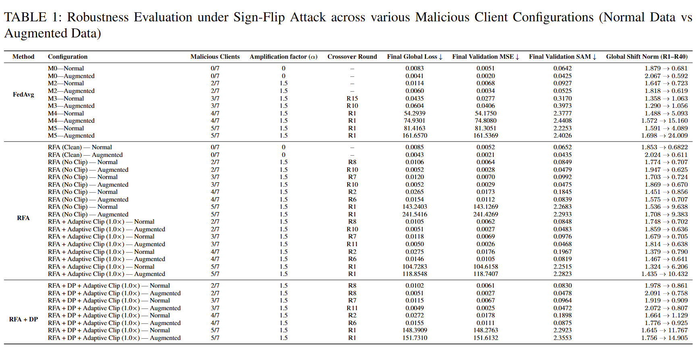
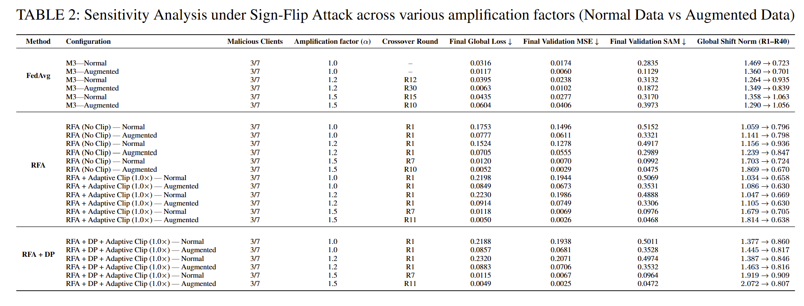
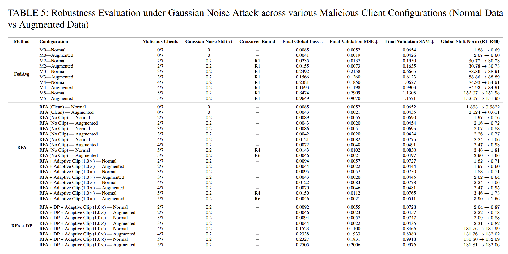
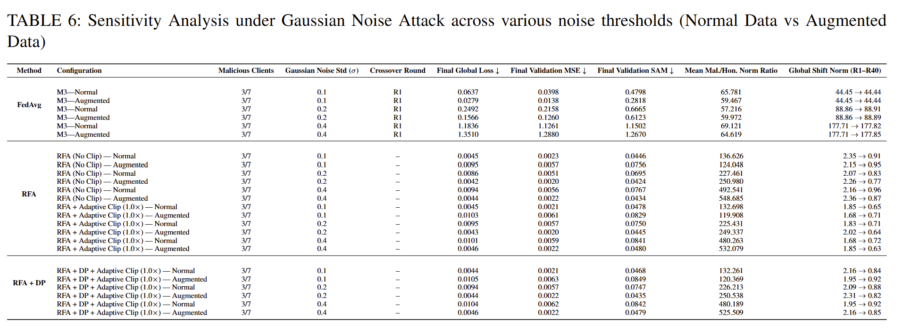

# Poisoning Attack Simulation in Federated Hyperspectral Crop Anomlay Detection

- This repository contains the client-server simulation of `Sign-Flip Attack` and `Gaussian Attack` for hyperspectral crop anomaly detection in the federated environment using varying malicious client settings.
- **Description:** It leverages `FedAVG` strategy as the baseline Federated setting. It compares the reconstruction performance of `Robust Federated Aggregation (RFA)` with different defensive mechanism (Clipping, Adaptive Clipping, Clipping + DP Noise) against FedAvg.
- **Model:** A three-dimensional Residual Autoencoder model is developed for crop anomaly detection.
- **Dataset:** Created 7 clients dataset splits (.npy) to simulate the distributed federated client data leveraging `Normal` and `Augmented` variations. 
- **Evaluation Metrics:** `Global Loss`, `Validation-MSE`, `Validation-SAM`, `Global Shift-Norm`.
- **Sensitivity Analysis:** Performs the sensitivity analysis across various `amplification factor` for `sign-flip` attack and varying `gaussian noise std factor` for `gaussian-noise-amplification` attack.
- **AUROC Analysis:** Compares the crop-anomaly detection using `MSE-based AUROC` and `SAM-based AUROC`.
- Code Repository is maintained in three separate branches for each different strategies: `fedavg-sign-flip`, `fedavg-gaussian-noise`, `RFA`.

## Evaluation Results

### 1. Sign-Flip Attack (Reconstruction Metrics)

### 2. Sign-Flip Attack (Sensitivity Analysis)

### 3. Gaussian Noise Amplification Attack (Reconstruction Metrics)

### 4. Gaussian Noise Amplification Attack (Sensitivity Analysis)

